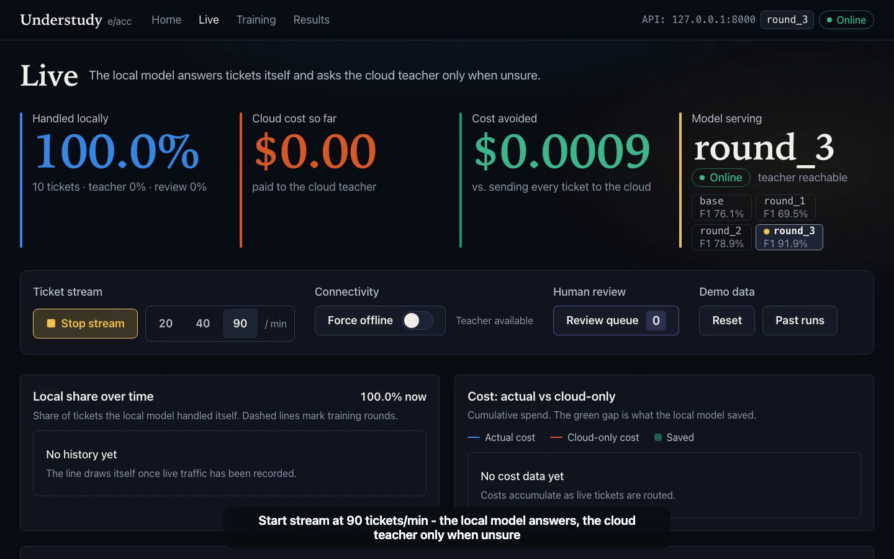
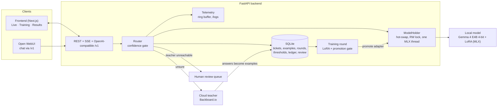

<div align="center">

# Understudy

**A small local model answers support tickets. A cloud teacher steps in only when it is unsure. Every teacher answer trains the local model.**

[Explainer](https://understudy-explainer.vercel.app) · [Demo video](#demo) · [Architecture](#architecture) · [Quickstart](#quickstart) · [API](#api)

Built by team **e/acc** for the Awign Hackathon (Open Theme).

[](https://understudy-explainer.vercel.app/#demo)

</div>

---

## Contents

- [Overview](#overview) · [Demo](#demo) · [How it works](#how-it-works) · [Confidence](#how-confidence-is-computed)
- [Results](#results) · [Architecture](#architecture) · [Repository layout](#repository-layout)
- [Quickstart](#quickstart) · [Configuration](#configuration) · [API](#api) · [Training](#training-rounds)
- [Observability](#observability) · [Testing](#testing) · [Security](#security-notes) · [Limitations](#limitations) · [Credits](#credits)

## Overview

Gig-work platforms receive thousands of support tickets: a payment that has not arrived, a stuck KYC document, an app that crashes at login. Each ticket needs a **category** (A to H) and a **priority** (P1 to P4), and the category decides which team owns it.

Sending every ticket to a frontier model is accurate but expensive, slow, and ships worker data off the device. A small model alone is cheap and private but is wrong too often and never improves. Understudy combines them:

1. A **local model** (Gemma 4 E4B, 4-bit, MLX, Apple silicon) classifies every ticket and reports a **confidence**.
2. Below a calibrated **threshold**, a **cloud teacher** answers instead. Its answer is saved as a training example.
3. If the teacher is unreachable, the ticket goes to a **human review queue**. The system never guesses silently.
4. A **LoRA training round** fine-tunes the local model on the saved teacher answers, on the same machine.
5. A **promotion gate** scores the new adapter on a held-out test set and promotes it only if category macro-F1 strictly improves.

The result is a model that needs the teacher less over time, with an audit trail of why each model was or was not promoted.

## Demo

[](docs/media/demo.mp4)

[Download the recording (MP4, 2 min 39 s)](docs/media/demo.mp4) · [Watch it in the explainer](https://understudy-explainer.vercel.app/#demo)

The recording shows, in order: the FastAPI Swagger UI, the landing page, the Live page with a 90 tickets/min stream and its share and cost charts, the backend telemetry page with per-ticket logits and probabilities, the review queue, archived past runs, and the Training and Results pages.

## How it works

```
ticket ──► local model ──► confidence >= threshold? ──yes──► answer served locally
                                   │
                                   no
                                   ▼
                       cloud teacher reachable? ──yes──► teacher answer (saved as training example)
                                   │
                                   no
                                   ▼
                          human review queue
```

Each training round: collect teacher examples, LoRA fine-tune locally, score on the held-out test set, then promote only on a strict macro-F1 gain. The reason is stored either way.

Output per ticket is `{"category": "A".."H", "priority": "P1".."P4"}`. The owning team is a fixed lookup from the category (`backend/schemas.py`).

| Letter | Category | Letter | Category |
|---|---|---|---|
| A | Payment delay | E | App bug / login |
| B | Payment dispute | F | Submission problems |
| C | KYC / onboarding | G | Account suspended |
| D | Task assignment | H | Other |

## How confidence is computed

Before writing its answer, the model gives every possible next token a raw score (a **logit**). Understudy reads only the eight scores for the letters A to H, turns them into probabilities with a softmax, and defines **confidence as the probability of the chosen letter**.

```
softmax(logit_A .. logit_H)  →  8 probabilities summing to 1
confidence = probability of the chosen letter
```

The **threshold is calibrated per model version**: the lowest value that still gives at least 95% accuracy above it on the validation set. It is stored in the `thresholds` table (round 3 serves with `0.4472`).

Priority (P1 to P4) is decoded from generated text and has no confidence score. Confidence gates the category only.

Every classification is logged with its logits and probabilities, and the telemetry page draws them as bars so the decision can be inspected per ticket.

## Results

Evaluated on `data/test.jsonl` (n = 200).

| Model | Category accuracy | Category macro-F1 | Priority accuracy | Promoted |
|---|---|---|---|---|
| `base` (no adapter) | 75.5% | 76.1% | 32.5% | n/a |
| `round_1` | 73.0% | 69.5% | 54.5% | No (did not beat base) |
| `round_2` | 78.5% | 78.9% | 47.0% | Yes |
| `round_3` (serving) | 92.0% | 91.9% | 79.5% | Yes |

> **These scores are provisional.** The test labels were produced by the teacher model, not by people. Read the table as a relative comparison between rounds, not an absolute accuracy claim. Gold labels can be added in `data/test_gold.jsonl`; the evaluator uses them automatically and drops the `provisional` flag.

Other measured figures:

- **Inference latency:** a single-pass classifier (one forward pass fills the KV cache, then decoding continues from it) cut median latency from 548 ms to 378 ms (-31%) on the same hardware, with identical confidences and equal or better accuracy against the gold sample. In a later live run the backend's median end-to-end classify time was about 354 ms.
- **Recorded demo run:** about 99% of streamed tickets were answered locally. Teacher spend was roughly $0.0002 for several hundred tickets, versus about $0.03 to send them all to the cloud.
- **Training:** a LoRA round took between 2.7 and 33 minutes on an Apple M5 (16 GB) Mac, at a recorded cost of $0.

## Architecture



Design decisions worth knowing:

- **One MLX thread.** MLX streams are per thread, so model loading and inference run on a single dedicated thread. Using the model from web worker threads crashes.
- **One model in RAM.** Training pauses and unloads the serving model, then hot-swaps to the new adapter. Training and serving never hold two models at once.
- **Single-pass inference.** The prompt is processed once; the same pass yields the confidence and the cache the priority is decoded from.
- **One round backend.** `backend/round_backend.py` is the only implementation of the training backend, used by both the API and the CLI.
- **Honest numbers.** Every figure the API returns comes from SQLite or `eval/results/*.json`. There is no mock data layer.

## Repository layout

| Path | Purpose |
|---|---|
| `backend/` | FastAPI app, SQLite, classifiers (`mlx` / `fake`), router, hot-swap holder, SSE, telemetry (`/logs`), archive, OpenAI-compatible `/v1` |
| `frontend/` | Next.js dashboard: Live, Training, Results |
| `training/` | `mlx_local` LoRA trainer and `round.py` (train, score, promote) |
| `eval/` | Metrics and the scoring runner; results in `eval/results/` |
| `data/` | Ticket generation, teacher labelling, splits, audit; `train/val/test/demo.jsonl` |
| `common/teacher.py` | Backboard.io client (cache, rate limit, retries, real token counts) |
| `scripts/` | `live_test.py` (end-to-end check), `snapshot.py`, `demo_reset.sh`, `start_webui.sh` |
| `docs/` | `spike.md` (measured findings), `explainer/` (the public explainer page), `media/` (demo video) |
| `tests/` | Backend test suite |

## Quickstart

**Requirements:** an Apple-silicon Mac (the local model runs on MLX), Python 3.11, Node 20+, and a [Backboard.io](https://backboard.io) API key for the cloud teacher.

```bash
# 1. Backend environment
python3.11 -m venv backend/.venv
backend/.venv/bin/pip install -r requirements.txt mlx-lm
cp .env.example .env        # then set BACKBOARD_API_KEY and DEMO_KEY (never commit .env)

# 2. Run the API with the real local model
CLASSIFIER=mlx TEACHER=real DB_PATH=logs/demo.sqlite \
  backend/.venv/bin/uvicorn backend.app:app --host 127.0.0.1 --port 8000

# 3. Run the dashboard (second terminal)
cd frontend && npm install && npm run build && npm start -- -p 3001
```

Open:

- Dashboard: `http://127.0.0.1:3001/live?api=http://127.0.0.1:8000&key=<DEMO_KEY>` (the key is saved in the browser and removed from the URL)
- API docs (Swagger): `http://127.0.0.1:8000/docs`
- Telemetry: `http://127.0.0.1:8000/logs`

**No model or no API key?** Run the whole stack with fakes, useful for UI work:

```bash
CLASSIFIER=fake TEACHER=fake backend/.venv/bin/uvicorn backend.app:app --port 8000
```

`./start.sh` starts the backend and Open WebUI together; Open WebUI chats through the backend's `/v1`, so no separate model server is needed.

### Rebuilding the data (about $2, about 15 minutes)

```bash
PY=backend/.venv/bin/python
$PY data/gen.py --n 1900                        # generator model, resumable, cached
TEACHER_RATE=10 $PY data/label.py --workers 16  # teacher labels, strict JSON
$PY data/split.py && $PY data/audit.py --file data/labeled.jsonl
```

## Configuration

Set in `.env` (see `.env.example`):

| Variable | Purpose |
|---|---|
| `BACKBOARD_API_KEY` | Access to the cloud teacher and generator through Backboard.io |
| `TEACHER_MODEL` | Teacher, as `provider/model` (default `openai/gpt-6-luna`) |
| `TEACHER_PRICE_IN_PER_M` / `TEACHER_PRICE_OUT_PER_M` | USD per 1M tokens, used for the cost ledger |
| `GENERATOR_MODEL` and prices | Synthetic ticket generator (default `google/gemini-2.5-flash`) |
| `LOCAL_MODEL` | Local model id (default `mlx-community/gemma-4-e4b-it-4bit`) |
| `DB_PATH` | SQLite path (default `understudy.sqlite`) |
| `DEMO_KEY` | Shared secret required on every state-changing request (`X-Demo-Key`) |

Runtime switches: `CLASSIFIER=mlx|fake`, `TEACHER=real|fake`, `DEMO_PATH` (replay file for the stream), `SNAPSHOT_DIR` (where Reset archives go).

## API

Interactive docs live at `/docs`. Main routes:

| Route | Description |
|---|---|
| `POST /api/classify` | Classify one ticket through the router |
| `POST /api/stream/start` · `/stop` | Replay `data/demo.jsonl` at a chosen rate |
| `GET /api/health` | Status, serving model, mode, and whether a stream is running |
| `GET /api/metrics/summary` · `/timeseries` | Local share, cost, cost avoided, trends |
| `GET /api/tickets/recent` · `/api/review_queue` | Recent tickets and the human review queue |
| `GET /api/rounds` · `/api/eval/compare` | Training rounds and model comparison |
| `POST /api/train/round` | Start a local LoRA round (progress over SSE) |
| `POST /api/model/activate` · `GET /api/model/versions` | Hot-swap the serving model |
| `POST /api/mode/offline` | Force offline mode (unsure tickets go to review) |
| `POST /api/demo/reset` · `GET /api/snapshots[/{id}]` | Archive and zero the live counters; browse archived runs |
| `GET /api/events` | Server-sent events (predictions, mode, rounds) |
| `GET /api/telemetry` · `/api/logs` · `/logs` | Metrics, log tail, and the log dashboard |
| `/v1/chat/completions` | OpenAI-compatible chat against the local model |

State-changing routes require the `X-Demo-Key` header (`/v1` also accepts a Bearer token).

## Training rounds

From the dashboard, or from the CLI:

```bash
MLX_PYTHON=$PWD/../../../.venv/bin/python CLASSIFIER=mlx \
  backend/.venv/bin/python -m training.round --backend mlx_local --seed-from-train-pool --iters 300
```

`--seed-from-train-pool` seeds the pool from the teacher labels in `data/train.jsonl`, recorded as `source='seed_train_pool'`. Promotion requires a strict macro-F1 gain over the serving model. The outcome and reason are stored in the `rounds` table and shown on the Training page. Adapters are written to `adapters/round_N` (not committed).

## Observability

- **`/logs`** is a self-contained dashboard: classify latency by stage (`model_forward`, `model_generate`, `teacher`, `db_write`), HTTP routes, memory (process and MLX), teacher health, and a filterable log tail. Each `classify` line carries the logits and probabilities behind its confidence.
- **`GET /api/telemetry`** returns the same numbers as JSON; **`GET /api/logs`** returns the ring buffer (3000 records) with `after`, `limit`, `level` and `kind` filters.
- Dashboard polling is kept out of the log tail, and auth failures are logged as warnings without the keys.

## Testing

```bash
backend/.venv/bin/python -m pytest tests -q        # backend suite (87 tests)
backend/.venv/bin/python scripts/live_test.py      # end-to-end check against a running backend
```

## Security notes

- Secrets live in `.env`, which is git-ignored. Only `.env.example` is committed.
- The demo key is a shared secret for a hackathon demo, not user authentication. Anyone holding it can start a training round or reset the data. Do not expose a backend publicly without putting real access control in front of it.
- Cloudflare quick tunnels do not deliver server-sent events; the frontend falls back to polling when the stream stalls.

## Limitations

- **Provisional evaluation.** Test labels come from the teacher, not from people, so absolute accuracy is unverified.
- **Apple silicon only** for the local model (MLX). The fake classifier runs anywhere for development.
- **Single-node, single-writer.** SQLite and one MLX thread are right for a demo; scaling out needs a different serving layer.
- **Priority has no confidence score**, so it is not gated.
- The corpus is synthetic (generated, then teacher-labelled). Real tickets will shift the distribution.
- No license file is included yet.

## Credits

- Local model: Gemma 4 E4B (4-bit) via [MLX](https://github.com/ml-explore/mlx) and `mlx-lm`.
- Cloud teacher and generator through [Backboard.io](https://backboard.io).
- Demo video music: "Floating Cities" by Kevin MacLeod ([incompetech.com](https://incompetech.com)), licensed under [Creative Commons: By Attribution 4.0](https://creativecommons.org/licenses/by/4.0/).
